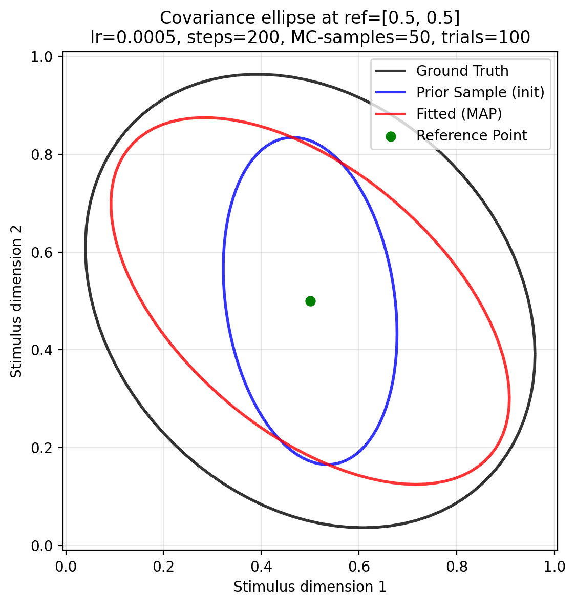
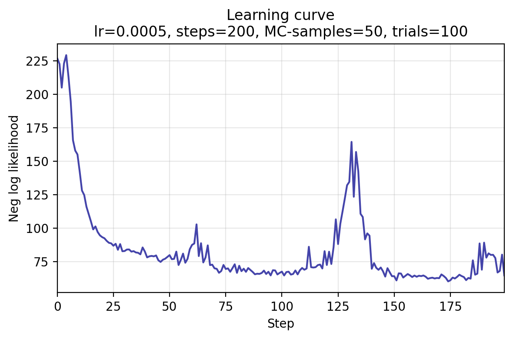

<div align="center">
    <picture>
      <source srcset="images/psyphy_logo.png" media="(prefers-color-scheme: light)"/>
      <source srcset="images/psyphy_logo.png"  media="(prefers-color-scheme: dark)"/>
      
    </picture>
    <h3>Active-learning-driven adaptive experimentation in psychophysics</h3>
</div>


<h4 align="center">
  <a href="https://flatironinstitute.github.io/psyphy/#install/">Installation</a> |
  <a href="https://flatironinstitute.github.io/psyphy/reference/">Documentation</a> |
  <a href="https://flatironinstitute.github.io/psyphy/examples/wppm/full_wppm_fit_example/">Examples</a> |
  <a href="https://flatironinstitute.github.io/psyphy/CONTRIBUTING/">Contributing</a>
</h4>

---

## Quick start: fit your first covariance ellipse

Below is the minimal end-to-end workflow: simulate 1,000 oddity-task trials at a single
reference point, fit the Wishart Process Psychophysical Model (WPPM) by maximum a posteriori
(MAP) optimization, and plot the result. It doesn't need a GPU and runs in under a minute on CPU.

> The complete runnable script is
> [`quick_start.py`](https://github.com/flatironinstitute/psyphy/blob/main/docs/examples/wppm/quick_start.py).
> The [quick start](examples/wppm/quick_start.md) page explains each step.

### Imports

```python title="Imports"
--8<-- "docs/examples/wppm/quick_start.py:imports"
```

### Compute settings

```python title="Compute settings"
--8<-- "docs/examples/wppm/quick_start.py:compute_settings"
```

### Ground-truth model + simulate data

```python title="Ground-truth model"
--8<-- "docs/examples/wppm/quick_start.py:truth_model"
```

```python title="Simulate data"
--8<-- "docs/examples/wppm/quick_start.py:simulate_data"
```

### Build model and fit

```python title="Model definition"
--8<-- "docs/examples/wppm/quick_start.py:build_model"
```

```python title="Fit with MAPOptimizer"
--8<-- "docs/examples/wppm/quick_start.py:fit_map"
```

### Results

<div align="center">
  
  <p><em>Black: ground truth. Dashed blue: the prior sample the fit started from. Red: MAP fit.</em></p>
</div>

<div align="center">
  
  <p><em>Per-trial negative log-posterior over optimizer steps.</em></p>
</div>
